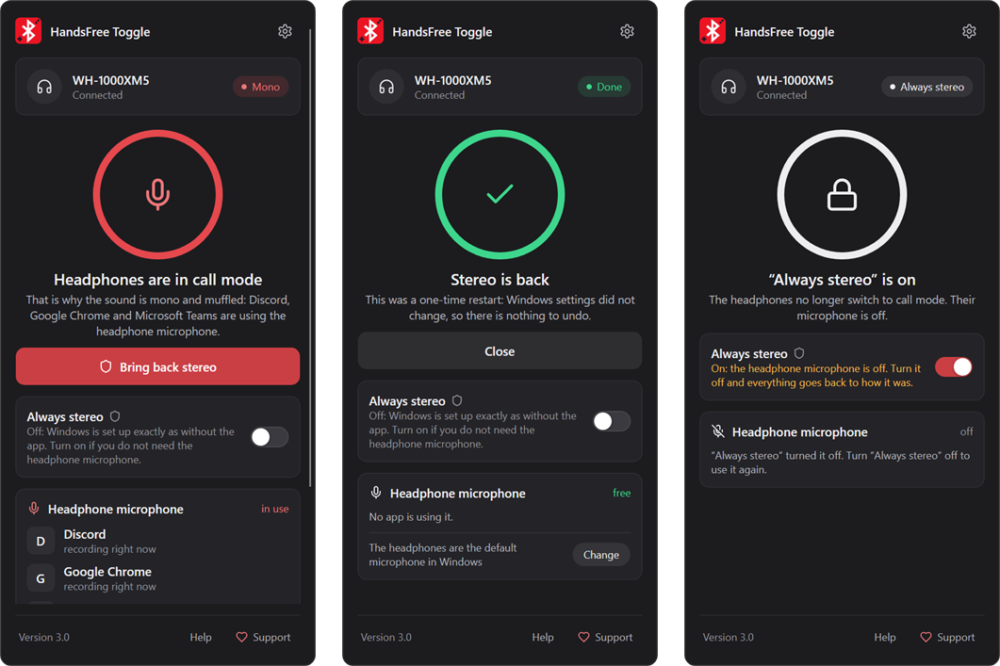
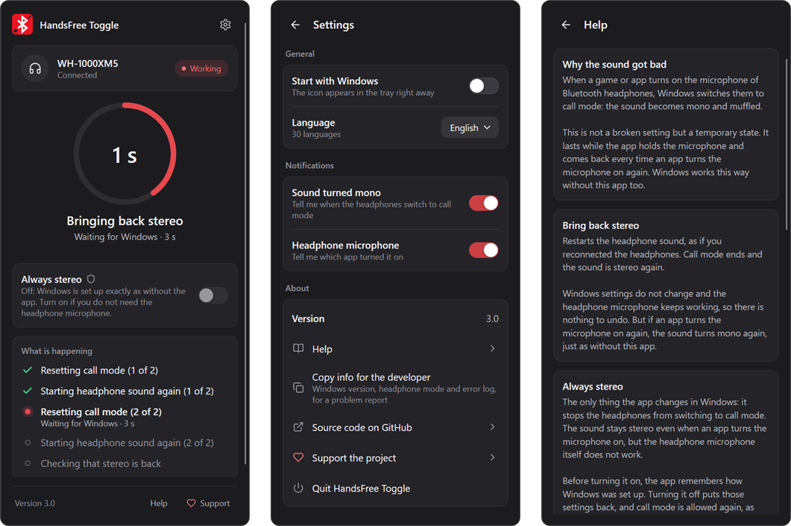

<p align="center">
  
</p>

<h1 align="center">BluetoothHandsFreeToggle</h1>

<p align="center">
  <strong>Fix low-quality Bluetooth headset audio and stuck Hands-Free mode on Windows 10 and Windows 11.</strong>
</p>

<p align="center">
  Built for Call of Duty and Warzone players, gamers, streamers, developers, and anyone whose headphones suddenly sound like a phone call.
</p>

<p align="center">
  <a href="https://github.com/Avazbek22/BluetoothHandsFreeToggle/releases/latest">
    
  </a>
  <a href="https://github.com/Avazbek22/BluetoothHandsFreeToggle/releases">
    
  </a>
  
  
  
  
  
</p>

<p align="center">
  <a href="#app-demo">Demo</a> •
  <a href="#download">Download</a> •
  <a href="#typical-use-cases">Use cases</a> •
  <a href="#what-the-buttons-do">Buttons</a> •
  <a href="#quick-start">Quick start</a> •
  <a href="#languages">Languages</a> •
  <a href="#troubleshooting-playbook">Troubleshooting</a> •
  <a href="#frequently-asked-questions">FAQ</a> •
  <a href="#build-from-source">Build</a>
</p>

---

> **Call of Duty, Warzone, Discord, or another game opened your Bluetooth microphone—and now the whole game sounds muffled, compressed, or mono?**

BluetoothHandsFreeToggle is a free, open-source Windows tray app that fixes Bluetooth headphones stuck in mono, muffled "phone call" sound on Windows 10 and Windows 11. Windows switches headphones from high-quality A2DP stereo to the Hands-Free Profile (HFP) as soon as Call of Duty voice chat, Discord, a browser, or recording software opens the headset microphone—and sometimes fails to switch back. The app shows when your headphones drop into call mode, names the app that took the microphone, and brings stereo back with one click. **Always stereo** keeps it that way if you use another microphone, and turning it off puts Windows back exactly as it was.

---

<a id="app-demo"></a>
## App demo 🎬

<p align="center">
  
</p>

Click the tray icon: the panel shows whether your headphones play in stereo or are stuck in call mode, which apps hold the headset microphone, and one button to bring stereo back.

<p align="center">
  
</p>

Every action shows what Windows is doing right now, settings are one click away, and the built-in help explains in plain words what each button changes and how to undo it.

---

<a id="download"></a>
## Download 🚀

**Latest GitHub release:**
👉 [https://github.com/Avazbek22/BluetoothHandsFreeToggle/releases/latest](https://github.com/Avazbek22/BluetoothHandsFreeToggle/releases/latest)

**Install via WinGet (Windows):** `winget install OlimoffDev.BluetoothHandsFreeToggle`

---

<p align="center">
  <a href="https://boosty.to/avazbek22">
    
  </a>
</p>

## Why use it?

| 🎮 Game-friendly | 🛡️ Recoverable | ⚡ Fast |
|:---|:---|:---|
| Fix audio left in call mode after games, voice chat, or capture software. | Always stereo saves the original Windows service state before changing anything and puts it back exactly. | Download one self-contained `.exe`; no installer, no background service, and no separate .NET runtime. |

Additional highlights:

- Lives in the tray: the dot on the icon shows stereo, call mode, or Always stereo at a glance.
- **Bring back stereo** keeps the headset microphone working.
- The panel names the apps that keep the headset in call mode (for example, "Discord is using the headphone microphone") and warns when the headset is the default Windows microphone.
- Optional Windows notifications when the headphones switch to call mode.
- **Always stereo** blocks call mode for reliable high-quality playback.
- Turning Always stereo off returns the exact saved service startup and running state.
- Final state verification after every operation, with a report you can copy for the developer.
- **Copy info for the developer** in Settings copies the app and Windows version, the headphone mode, and the error log for a bug report, with your user folder hidden.
- If the panel ever cannot start, Windows shows a message instead, and with Always stereo on it offers to put Windows back first.
- 30-language interface with smart Windows language detection and a saved manual choice.
- Built-in help and safe handling of partial failures.

## Typical use cases

### Call of Duty or Warzone voice chat ruins Bluetooth audio

You launch Call of Duty, enter a Warzone match, or enable voice chat in a Black Ops multiplayer lobby. Windows activates the headset microphone, switches from A2DP stereo to HFP call mode, and gunfire, footsteps, music, and spatial audio suddenly sound thin or muffled.

Close or disable the in-game Bluetooth microphone first, then click **Bring back stereo**. If you use a laptop, USB, or standalone microphone and only need the headset for playback, turn on **Always stereo** so Windows cannot select Bluetooth HFP again.

### The game closed, but the headset is still stuck in Hands-Free mode

Some games and communication apps release the microphone without Windows restoring the original stereo route. **Bring back stereo** restarts the active HFP service without changing its startup configuration and can release that stuck call session.

### Discord and a game are fighting over the headset

Running Discord, Steam Chat, Xbox Game Bar, or in-game voice chat alongside a game can keep the Bluetooth microphone active. The panel shows which app it is. Select a laptop or USB microphone in that app, then click **Bring back stereo** to recover high-quality game audio.

### Streaming or recording software triggered low-quality sound

OBS, NVIDIA ShadowPlay, browser recording tools, and other capture software may open the default headset microphone. After changing their input device or stopping capture, click **Bring back stereo** to return to stereo playback.

### You want maximum game audio quality and use a separate microphone

**Always stereo** is designed for this setup. It disables Bluetooth Classic HFP system-wide, forcing Windows to prioritize high-quality A2DP playback. Turn it off later to return the previous HFP configuration; if HFP was enabled before, the headset microphone becomes available again.

<a id="what-the-buttons-do"></a>
## What the buttons do

| Control | What it does | Headset microphone | Best used when |
|:---|:---|:---:|:---|
| **Tray icon and panel** | Reads the supported HFP services and shows which apps are using the headset microphone, without changing anything. | Available | You want to see the current state or find the app that switched the headset to call mode. |
| **Bring back stereo** | Restarts only active HFP services without changing their startup type, and recovers an HFP service stuck in the Stopping state. | Preserved | A game or voice app released the microphone, but Windows stayed in call mode. |
| **Always stereo: on** | Stops and disables Bluetooth Classic HFP system-wide after saving the original state. | Disabled | You need reliable stereo playback and can use another microphone—or no microphone. |
| **Always stereo: off** | Exactly restores the startup and Running/Stopped state saved when it was turned on. Without a saved state, it uses `Manual + Running` recovery defaults. | Previous state | You want the headset microphone back and Windows as it was before. |

The caption under the switch always says which case you are in: **Off** means Windows is set up exactly as without the app; **On** means the headset microphone is off until you turn the switch off.

> [!IMPORTANT]
> Bluetooth Classic cannot provide A2DP-quality stereo playback while the headset's HFP microphone is actively in use. Bring back stereo can clear a **stuck** HFP session, but it cannot bypass this Bluetooth limitation. Always stereo solves the quality problem by disabling HFP, which also disables the Bluetooth headset microphone.

On Windows 11, A2DP and HFP are exposed through unified audio endpoints, and Windows automatically selects HFP when an application opens the headset microphone. For the platform details, see [Microsoft's Bluetooth Classic Audio documentation](https://learn.microsoft.com/windows-hardware/drivers/bluetooth/bluetooth-classic-audio).

## Quick start

1. Download `BluetoothHandsFreeToggle-v<version>-win-x64.exe` (or `win-arm64` for ARM PCs) from the [latest release](https://github.com/Avazbek22/BluetoothHandsFreeToggle/releases/latest), or install it with WinGet.
2. Run it. The icon appears in the Windows tray (check the hidden icons arrow and pin it to the taskbar if you like).
3. Click the icon. If the headphones are in call mode, the panel names the app that is using the headset microphone: close it or choose another microphone in it.
4. Click **Bring back stereo**. Windows asks for permission each time the app changes services: click **Yes**.
5. If you do not need the headset microphone, turn on **Always stereo**.
6. Turn **Always stereo** off at any time to put everything back exactly as it was.

After an operation, reconnect the headset or restart audio playback if a game cached the previous Windows audio route.

Settings (the gear in the panel) let you start the app with Windows, turn notifications on or off, and pick a language. They are stored in:

```text
%AppData%\BluetoothHandsFreeToggle\
```

## Languages

On the first run, BluetoothHandsFreeToggle checks the ordered Windows UI language preferences and selects the first supported match. Regional fallbacks are handled deliberately: Traditional and Simplified Chinese stay separate, Spanish distinguishes Spain and Latin America, Portuguese distinguishes Brazil and Portugal, and Norwegian variants resolve to Bokmål. Pick another language in the panel's settings; the choice is remembered for future runs.

| | Supported interface languages |
|:--|:--|
| **Core** | English, Русский |
| **East Asia** | 简体中文, 繁體中文, 日本語, 한국어 |
| **Western Europe** | Deutsch, Français, Español (España), Español (Latinoamérica), Português (Brasil), Português (Portugal), Italiano, Nederlands |
| **Northern Europe** | Svenska, Dansk, Norsk bokmål, Suomi |
| **Central & Eastern Europe** | Polski, Українська, Čeština, Magyar, Română, Ελληνικά, Български |
| **Türkiye & Southeast Asia** | Türkçe, ไทย, Bahasa Indonesia, Bahasa Melayu, Tiếng Việt |

## Troubleshooting playbook

### Call of Duty or Warzone Bluetooth audio sounds muffled

1. Disable in-game voice chat or select a laptop/USB microphone in the Call of Duty audio settings.
2. Close any lobby, overlay, or background voice application still using the Bluetooth microphone.
3. Click **Bring back stereo**.
4. Restart the game audio or reconnect the headset if the old route was cached.
5. If you do not need the headset microphone, turn on **Always stereo** for reliable A2DP playback.

### Audio became bad after voice chat

1. Exit every app that might be capturing the Bluetooth microphone.
2. Click **Bring back stereo**.
3. Restart playback or reconnect the headset if necessary.

### Audio becomes bad again immediately

An application is probably still opening the HFP microphone. The panel names every app that is recording from the headset microphone right now. Also check:

- In-game voice chat and microphone settings.
- Discord, Steam Chat, Teams, or another communication app.
- OBS, ShadowPlay, audio recorders, browser permissions, and background tabs.
- The selected input device in Windows and each running application.

Disable microphone access in that application, select a laptop/USB microphone, or turn on **Always stereo**.

### I need the headset microphone again

Turn **Always stereo** off. It returns the service configuration saved when you turned it on. If no saved state exists, the app uses conservative recovery defaults: `Manual + Running`.

### Turning Always stereo off only completed partially

Turn it off again. The saved state is intentionally kept until every supported service has been successfully restored and verified.

### The panel does not open

Windows shows a message with the reason and the log location instead of the panel. If Always stereo is on at that moment, the same message offers to put Windows back as it was, so the headset microphone never stays switched off. Attach the log from `%LocalAppData%\BluetoothHandsFreeToggle\logs\app.log` to your [issue report](https://github.com/Avazbek22/BluetoothHandsFreeToggle/issues/new).

## Safety and recovery

Before Always stereo changes service configuration, the original state is stored in:

```text
%ProgramData%\BluetoothHandsFreeToggle\backup.json
```

Recovery behavior is intentionally conservative:

- If a backup cannot be created, Always stereo makes no service changes.
- Turning Always stereo on again preserves the first original-state backup.
- Backups are written atomically through a temporary file and stored with a protected Windows ACL.
- Partial restore attempts keep the backup for another retry.
- A fully successful and verified restore removes the backup.
- A system-wide named mutex prevents concurrent operations in different Windows sessions from racing over services or backup state.
- Every operation reads the final Windows service state and reports partial failures.
- Live progress is shown while services stop and start, so a slow operation never looks frozen.
- Service changes run in a separate elevated worker that reports back to the tray app over a named pipe only that worker can connect to.
- Always stereo disables HFP startup **before** stopping the service, so device triggers or SCM recovery actions cannot restart it midway.

### Hung service recovery

Windows sometimes leaves an HFP service hung in the *Stopping* state. The Service Control Manager then rejects every further start or stop request until the service's process exits, which normally means a reboot. BluetoothHandsFreeToggle detects this case and resolves it safely:

- Transitions are tracked with the service's own checkpoint and wait hint, the way the SCM protocol intends. A slow service that keeps reporting progress is never treated as hung.
- A service is considered hung only after it stops reporting progress for its declared wait hint (clamped to 5–15 seconds).
- The host process is terminated only if **all** of these hold, re-verified while a handle to the process is held so its PID cannot be reused in between:
  - the service is still pending in exactly that process;
  - the process hosts nothing but `BTAGService` / `BthHFSrv`;
  - the process image is `%SystemRoot%\System32\svchost.exe`.
- A shared service host (common on PCs with less than 3.5 GB RAM), an unexpected host, or a failed termination is never forced. The app explains why and asks for a Windows restart instead. Always stereo's Disabled startup still takes effect after that restart.
- A service is force-recovered at most once per step. If it hangs again, the app stops and asks for a restart instead of looping.
- Restore keeps its backup until the restored state is fully verified, including after a required restart.

The app uses the Windows Service Control Manager API. It does **not**:

- Uninstall or replace Bluetooth drivers.
- Remove Bluetooth pairings.
- Modify headset firmware.
- Directly edit service startup values in the registry.
- Disable core Bluetooth services such as `bthserv` or `BluetoothUserService`.
- Terminate any process other than an isolated `svchost.exe` that hosts only a hung HFP service.

## Supported Windows components

The target list is intentionally small:

| Service | Purpose |
|:---|:---|
| `BTAGService` | Bluetooth Audio Gateway used for HFP on many Windows 11 systems. |
| `BthHFSrv` | Bluetooth Hands-Free service present on some Windows 10 systems. |

Always stereo affects Bluetooth Classic HFP **system-wide**, not one selected headset. Bluetooth LE Audio and vendor-specific Bluetooth stacks may behave differently.

### Compatibility

- Windows 10 or Windows 11.
- Official release builds: self-contained single-file `win-x64` and `win-arm64`.
- Bluetooth Classic headsets using A2DP/HFP.
- Showing the status needs no special rights. Windows asks for administrator permission (UAC) each time the app changes services.

## Frequently asked questions

### Why do my Bluetooth headphones sound bad in Call of Duty or Warzone?

Call of Duty voice chat can open the Bluetooth headset microphone. On Bluetooth Classic devices, Windows must then switch from high-quality A2DP stereo to the lower-bandwidth HFP call profile. The result can sound muffled, compressed, mono, or similar to telephone audio.

### Why is my Bluetooth headset still in Hands-Free mode after closing the game?

The game, an overlay, Discord, or another background process may still hold the microphone open. Windows can also leave the HFP session stuck after the microphone is released. Close every microphone user and click Bring back stereo.

### Can I use the Bluetooth headset microphone and high-quality game audio simultaneously?

Not with the Bluetooth Classic A2DP/HFP combination. A2DP provides high-quality stereo output, while HFP provides two-way call audio with reduced playback quality. Use a laptop or USB microphone if you want clear game audio and voice chat at the same time.

### Does this fix Bluetooth audio in Discord, Steam, OBS, and browsers?

It can fix audio that remains stuck in HFP after those applications stop using the headset microphone. If an application is still actively recording from the Bluetooth microphone, Windows will continue to require HFP until you change or disable that input.

### Is Always stereo permanent?

No. Always stereo stores the original service configuration first. Turn the switch off to return the saved startup and running state.

### How do I put everything back as it was before the app?

Bring back stereo changes nothing permanently. Always stereo is the only setting the app changes in Windows, so:

1. Turn **Always stereo** off if it is on.
2. In the panel's settings, turn off **Start with Windows**.
3. Quit the app and uninstall it (Settings → Apps, `winget uninstall`, or delete the file if you downloaded it yourself).

Do step 1 before uninstalling: once removed, the app can no longer restore the headset microphone. Only the app's settings in `%AppData%\BluetoothHandsFreeToggle` and its log in `%LocalAppData%\BluetoothHandsFreeToggle` remain; you can delete those folders.

### Does it work with AirPods, Sony, Bose, JBL, or my gaming headset?

The app works at the Windows level, not with a particular model. Windows switches every Bluetooth Classic headset to HFP the same way, whether it is AirPods, Sony WH/WF, Bose, JBL, Jabra, or a Bluetooth gaming headset. Bluetooth LE Audio devices and headsets with their own USB dongle use a different audio path and may not need the app at all.

### How is this different from turning off "Hands-Free Telephony" in Devices and Printers?

That manual workaround switches HFP off for one paired device and has to be undone by hand. Bring back stereo fixes a stuck call without changing anything, while Always stereo blocks call mode for every headset with one switch, remembers the original Windows state, and puts it back exactly when you turn it off.

### Does it need administrator rights or run in the background?

Showing the status needs no special rights. Windows asks for permission only when you click Bring back stereo or flip Always stereo; that part runs in a separate short-lived process. The app installs no service or driver, and it starts with Windows only if you turn that on in Settings.

### Do I need to install .NET?

No. The official `win-x64` release is a self-contained single executable. The .NET 10 SDK is required only when building the project from source.

## For developers

The codebase keeps Windows-specific operations separate from recovery logic:

```text
BluetoothHandsFreeToggle/
├── App/            Startup, single instance, elevated worker, and crash log
├── Core/           Stereo restart, Always stereo, restore, status, and backup logic
├── Gui/            Tray icon, panel, and notifications (Avalonia)
├── Localization/   30-language resources and smart culture matching
└── Windows/        Service Control Manager and Core Audio integration

BluetoothHandsFreeToggle.Tests/
└── Unit and headless UI tests for state transitions, backups, failures, the panel, and localization
```

Quality safeguards include nullable reference types, recommended .NET analyzers, warnings treated as errors, final-state verification, and unit tests for recovery-critical paths.

## Build from source

Requirements:

- Windows 10 or Windows 11.
- [.NET 10 SDK](https://dotnet.microsoft.com/download/dotnet/10.0).
- Git.

```powershell
git clone https://github.com/Avazbek22/BluetoothHandsFreeToggle.git
cd BluetoothHandsFreeToggle

dotnet restore
dotnet build --configuration Release --no-restore
dotnet test --configuration Release --no-build --no-restore
```

Create verified release artifacts for `win-x64` and `win-arm64`:

```powershell
.\scripts\Publish-Release.ps1
```

The release script requires a clean `master` branch synchronized with `origin/master`,
runs all tests, publishes both architectures, and generates SHA-256 checksums. For a
local packaging test from another branch or a dirty working tree:

```powershell
.\scripts\Publish-Release.ps1 -SkipRepositoryChecks
```

Release files are placed under:

```text
artifacts/release/v<version>/
```

Prepare and validate the next WinGet update from those local release artifacts:

```powershell
.\scripts\Publish-WinGet.ps1 `
  -Mode Update `
  -LocalArtifactsDirectory .\artifacts\release\v<version> `
  -LocalOnly `
  -NonInteractive
```

This produces x64/Arm64 manifests plus localized metadata for all 30 interface languages without submitting a pull request. After the matching GitHub release is public, rerun without `-LocalArtifactsDirectory`; add `-InstallTest` for the public installer check and `-Submit` only when you intentionally want WingetCreate to open the PR.

## Support the project

BluetoothHandsFreeToggle is free and open source. If it saved your game night, stream, meeting, or debugging session, consider supporting continued development and testing:

<p align="center">
  <a href="https://boosty.to/avazbek22">
    
  </a>
</p>

## Contributing

Bug reports, reproducible Windows/Bluetooth edge cases, and focused pull requests are welcome. The quickest way to report a problem: open Settings, click **Copy info for the developer**, and paste the result into a new issue together with your headset model and the app that triggered call mode.

- [Open an issue](https://github.com/Avazbek22/BluetoothHandsFreeToggle/issues/new)
- [View the source](https://github.com/Avazbek22/BluetoothHandsFreeToggle)

## License

Released under the [MIT License](LICENSE).

© 2026 Avazbek Olimov
